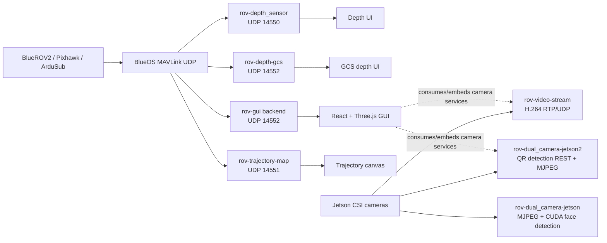
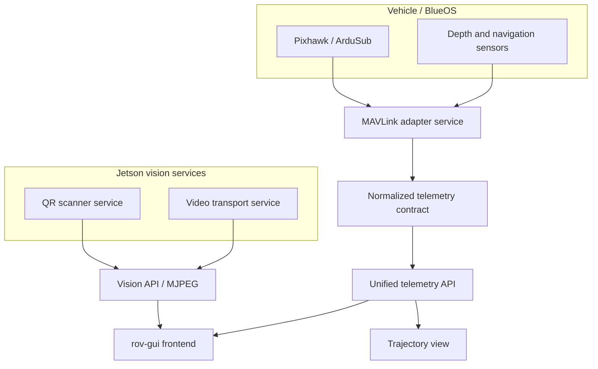

# ROV Project Documentation

Dokumentasi dan analisis arsitektur proyek ROV milik **Deikazen** yang nama repositorinya diawali `rov-`.

> **Cakupan analisis:** snapshot berbasis source dan dokumentasi pada branch `main`, 14 November 2026. Repositori `rover-*` dan `mavlink-for-rov` tidak termasuk karena tidak diawali `rov-`.

## Daftar proyek

| Repository | Peran | Teknologi utama | Port / input utama |
|---|---|---|---|
| [rov-gui](https://github.com/Deikazen/rov-gui) | Ground-station GUI terpadu untuk telemetry depth, trajectory, kamera, dan simulasi | Flask, React, TypeScript, Vite, Three.js, pymavlink | Backend `5001`, MAVLink UDP `14552`, frontend dev `5173` |
| [rov-depth-gcs](https://github.com/Deikazen/rov-depth-gcs) | Backend + dashboard sederhana untuk depth telemetry | Flask, HTML, pymavlink | HTTP `5001`, MAVLink UDP `14552` |
| [rov-depth_sensor](https://github.com/Deikazen/rov-depth_sensor) | Prototype pembacaan `VFR_HUD` dan tampilan depth | Flask, HTML, pymavlink | HTTP `5000`, MAVLink UDP `14550` |
| [rov-trajectory-map](https://github.com/Deikazen/rov-trajectory-map) | Dashboard trajectory/top-down map berbasis telemetry | FastAPI, HTML canvas, Uvicorn, pymavlink | HTTP `8007`, MAVLink UDP `14551` |
| [rov-video-stream](https://github.com/Deikazen/rov-video-stream) | Capture kamera CSI Jetson dan streaming H.264 melalui RTP/UDP | Python, OpenCV, GStreamer, NVENC | RTP/UDP `5601`, target `192.168.99.22` |
| [rov-dual_camera-jetson](https://github.com/Deikazen/rov-dual_camera-jetson) | Prototype dual-camera streaming dengan deteksi wajah CUDA | OpenCV CUDA, GStreamer, HTTP MJPEG | HTTP `8001`, CSI sensor `0` |
| [rov-dual_camera-jetson2](https://github.com/Deikazen/rov-dual_camera-jetson2) | Implementasi matang dual-camera QR/barcode scanner headless | Flask, OpenCV, GStreamer, CUDA opsional, pyzbar, Waitress | HTTP API `5000`, CSI sensor `0` dan `1` |

## Gambaran besar sistem



## Analisis per proyek

### 1. `rov-gui`

Ini adalah kandidat **platform utama**. Backend Flask menerima telemetry MAVLink dan menyediakan:

- `GET /api/telemetry`
- `POST /api/source` untuk memilih `real` atau `dummy`
- state bersama yang dilindungi `threading.Lock`
- worker MAVLink dan worker dummy

Frontend React/TypeScript menggunakan Three.js dan React Three Fiber untuk visualisasi 3D. Struktur repo juga menunjukkan modul trajectory, model 3D, kamera Jetson, webcam, QR detector, ultrasonic, dan simulator. Dengan demikian, repo ini berfungsi sebagai integrator UI, bukan hanya depth monitor.

**Arsitektur:** React/Vite frontend → REST Flask → worker MAVLink/dummy → Pixhawk/BlueOS. Modul kamera dan sensor tambahan berada di backend dan berpotensi menjadi adapter terpisah.

### 2. `rov-depth-gcs`

Versi Flask yang lebih ringkas dari backend depth pada `rov-gui`. `main.py` menjalankan dua thread daemon: pembaca `GLOBAL_POSITION_INT`/`VFR_HUD` dan generator data dummy. API mengembalikan depth meter/centimeter, rate, source, status MAVLink, dan batas maksimum 2 meter.

**Arsitektur:** satu proses Flask yang sekaligus menyajikan `index.html`, REST API, state telemetry, dan simulator. Cocok sebagai prototype atau service telemetry kecil.

### 3. `rov-depth_sensor`

Prototype paling sederhana untuk pembacaan depth. README menyebut `VFR_HUD`, tetapi implementasi juga membaca `GLOBAL_POSITION_INT`, lalu mengubah `relative_alt` menjadi depth. UI lokal dibuka otomatis pada `127.0.0.1:5000`.

**Arsitektur:** Flask monolith + HTML statis + worker MAVLink/dummy. Fungsinya tumpang tindih dengan `rov-depth-gcs`; perbedaan pentingnya adalah port/input UDP dan tingkat kelengkapan dokumentasi.

### 4. `rov-trajectory-map`

Dashboard FastAPI yang memelihara state `roll`, `pitch`, `yaw`, `depth`, `x`, dan `y`. Frontend melakukan polling sekitar 100 ms dan menggambar trajectory pada canvas. Backend menggunakan input MAVLink UDP `14551` dan berjalan pada port `8007`.

**Arsitektur:** HTML canvas → FastAPI/Uvicorn → worker MAVLink → Pixhawk. Repo ini lebih berfokus pada visualisasi lintasan daripada depth-GCS umum.

### 5. `rov-video-stream`

Pipeline kamera CSI Jetson yang membaca `nvarguscamerasrc`, mengubah frame melalui GStreamer, lalu meng-encode H.264 menggunakan `nvv4l2h264enc`. Output dikirim melalui RTP/UDP ke IP statis `192.168.99.22:5601`.

**Arsitektur:** CSI camera → GStreamer/OpenCV → NVENC H.264 → RTP payload → UDP receiver. Tidak ada REST API atau discovery; konfigurasi jaringan masih hardcoded di `stream.py`.

### 6. `rov-dual_camera-jetson`

Prototype dual-camera dengan satu capture thread, deteksi wajah CUDA, dan HTTP server MJPEG sederhana. Walaupun nama menyebut dual camera, entrypoint yang dianalisis masih membuka sensor `0`; implementasi lebih tepat dipandang sebagai proof-of-concept computer vision/streaming.

**Arsitektur:** CSI camera → GStreamer → OpenCV CUDA grayscale/face detection → shared frame → HTTP MJPEG (`/stream.mjpg`). Error pada capture/stream masih ditangani dengan pola yang sangat toleran sehingga observabilitas perlu diperbaiki sebelum production.

### 7. `rov-dual_camera-jetson2`

Implementasi paling lengkap untuk computer vision. Dua `CameraScanner` berjalan dengan capture dan decode thread masing-masing. Pipeline memakai GStreamer Jetson, koreksi fisheye, crop/resize, zoom kamera utama, decode QR/barcode pyzbar, deduplikasi history, dan CUDA remap opsional.

API Flask menyediakan health/config/status, scan per kamera, scan gabungan, history, snapshot JPEG, MJPEG stream, kontrol scan, dan kontrol zoom. Aplikasi sengaja single-process karena satu perangkat CSI tidak boleh dibuka oleh beberapa worker proses.

**Arsitektur:** CSI camera 0/1 → GStreamer → undistort CPU/CUDA → frame buffer → QR decode fast-path/fallback → detection state/history → REST + MJPEG API.

## Kontrak telemetry yang berulang

Beberapa repo memakai kontrak data yang hampir sama:

```json
{
  "source": "real",
  "depth": 0.0,
  "depth_cm": 0.0,
  "rate": 0.0,
  "mavlink_connected": true,
  "max_depth_m": 2.0,
  "max_depth_cm": 200.0
}
```

Mode `dummy` memakai osilasi sinusoidal agar UI dapat diuji tanpa hardware. Mode `real` umumnya memetakan:

- `GLOBAL_POSITION_INT.relative_alt` dari milimeter ke meter dan membalik tanda untuk depth bawah air.
- `VFR_HUD.climb` ke `rate`, dengan tanda dibalik agar positif berarti descending.

## Temuan lintas-repo

1. **Duplikasi depth service.** `rov-gui`, `rov-depth-gcs`, dan `rov-depth_sensor` memiliki worker MAVLink, dummy generator, shared state, dan endpoint yang sangat mirip.
2. **Port MAVLink belum distandardisasi.** Input yang dipakai adalah `14550`, `14551`, dan `14552`; setiap service memerlukan konfigurasi BlueOS berbeda.
3. **Kontrak API belum sepenuhnya konsisten.** Sebagian endpoint memakai error JSON `error`, sedangkan FastAPI memakai `detail`; nama dan keberadaan endpoint juga berbeda.
4. **Video masih memiliki dua jalur terpisah.** `rov-video-stream` memakai RTP/UDP, sedangkan dua repo Jetson lain memakai HTTP/MJPEG.
5. **Konfigurasi jaringan masih hardcoded.** Contoh utama adalah target UDP `192.168.99.22:5601` dan beberapa alamat/port MAVLink di source.
6. **Lifecycle berbeda-beda.** `rov-gui`/depth services memakai daemon threads tanpa shutdown terstruktur, sedangkan `rov-dual_camera-jetson2` sudah memiliki lifecycle `start/stop` dan signal handling yang lebih baik.
7. **Belum terlihat automation standar.** `rov-depth-gcs` secara eksplisit belum memiliki GitHub Actions; repo lain juga tidak menunjukkan kontrak CI/CD pada source yang dianalisis.
8. **Status maturity tidak sama.** `rov-dual_camera-jetson2` paling dekat ke service production, `rov-gui` paling dekat ke integrator, sementara `rov-depth_sensor` dan `rov-dual_camera-jetson` lebih cocok sebagai prototype.

## Rekomendasi arsitektur target



Prioritas implementasi:

1. Jadikan `rov-gui` sebagai shell UI/integrator, tetapi pindahkan pembacaan MAVLink ke satu adapter telemetry bersama.
2. Standarkan konfigurasi melalui environment variables: `MAVLINK_UDP_ENDPOINT`, `HTTP_PORT`, `VIDEO_TARGET`, dan batas depth.
3. Tetapkan kontrak API versi pertama, misalnya `/api/v1/telemetry`, `/api/v1/source`, `/api/v1/health`, dengan format error yang sama.
4. Gunakan satu port MAVLink yang didokumentasikan per deployment; jika multi-consumer diperlukan, gunakan router/forwarder MAVLink daripada membuat banyak listener manual.
5. Pertahankan `rov-dual_camera-jetson2` sebagai baseline vision service, lalu jadikan `rov-dual_camera-jetson` sebagai eksperimen/prototype terpisah.
6. Pilih satu transport video utama: RTP/UDP untuk latency rendah atau MJPEG/HTTP untuk integrasi browser sederhana; dokumentasikan adapter bila keduanya memang dibutuhkan.
7. Tambahkan test API untuk telemetry/source, health checks, logging terstruktur, graceful shutdown, dan workflow CI minimal untuk lint/type/import checks.

## Batasan analisis

Analisis ini dibuat dari README, struktur root, requirements, entrypoint, dan modul inti yang tersedia pada branch `main`. Hardware Jetson, konfigurasi BlueOS, wiring sensor, deployment aktual, serta isi frontend secara runtime belum diverifikasi. Port dan alamat yang tercantum adalah nilai yang terlihat di source/dokumentasi, bukan jaminan konfigurasi deployment aktif.
